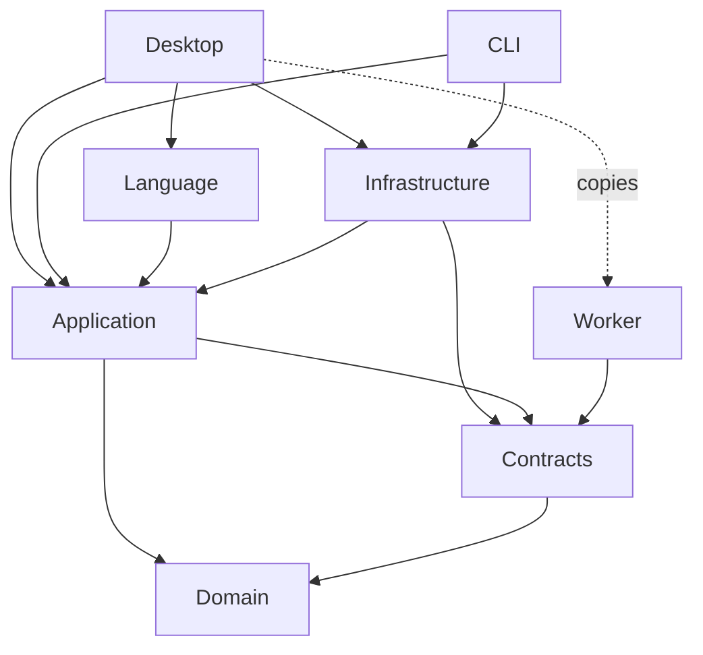
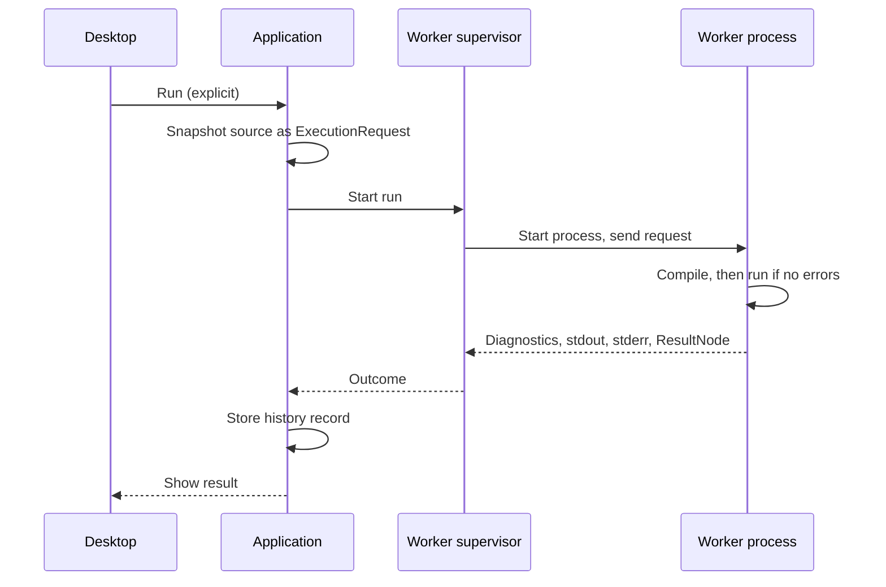

# CodePad architecture

This page states the module boundaries, the worker trust boundary and the storage rules for v0.1.
The owner issues hold the detailed rules. When this page and an owner issue disagree, the owner
issue wins. Fix this page in the same change.

For the product scope, see [PRODUCT.md](PRODUCT.md).

## Current state

[#1] created four projects: `Codepad.Domain`, `Codepad.Application`, `Codepad.Infrastructure` and
`Codepad.Desktop`. Each module has its own assembly. [#2] added the domain model. See
[Domain model](#domain-model). [#3] added storage. See
[Storage and retention](#storage-and-retention). [#4] added Contracts and Worker. See
[C# script semantics](#c-script-semantics) and [Worker protocol](#worker-protocol). [#5] added the C# editor, [#6] added completion and [#7] added the result panel. See [C# editor](#c-editor). [#8] added run history, [#9] added live JSON and [#10] added tabs, [#11] added the library and [#12] added the command palette and Run, and [#13] added the settings. [#19] creates
the CLI.

The Desktop app opens one window with a menu, a workspace region and a status region. The workspace
holds a tab strip. Each tab is a C# experiment (editor, diagnostics and result panel) or a live JSON
experiment, and autosave stores it. See [Tabs and session](#tabs-and-session). When the data folder or the
database is not usable, the workspace holds one C# editor that does not save. At startup
it reads an optional settings file and prepares the data folder. A problem with either does not
stop the startup. The status region shows it.

## Modules

[#1] defines these modules. [#19] adds the CLI module. [#1] can combine modules into one
assembly where that has a reason.

| Module | Holds | Must not depend on |
| --- | --- | --- |
| Domain | Experiment, execution request, outcomes, diagnostics, `ResultNode`, policies. See [#2]. | Avalonia, Roslyn, SQLite, OS APIs |
| Application | Use cases and the interfaces that they need, for example `ICSharpRunner`, `ICSharpAnalyzer` and `IUpdateService`. | Avalonia, SQLite, Roslyn, OS APIs |
| Infrastructure | Adapters for IO: SQLite storage, the worker supervisor (`WorkerSupervisor`), the GitHub Releases client, the update verifier. | Desktop, Roslyn |
| Language | The Roslyn language service of the editor: syntax coloring and diagnostics. See [#5]. | Desktop, Infrastructure, Worker, Avalonia, SQLite |
| Contracts | The versioned messages between the app and the worker, and the frame codec. See [#4]. | Desktop, Infrastructure, Application, Worker, Roslyn, SQLite, Avalonia |
| Worker | The child process that compiles and runs one C# snippet with Roslyn. See [#4]. | Desktop, Infrastructure, Application, SQLite, Avalonia |
| Desktop | The Avalonia UI and the composition root. | (the composition root can use all modules) |
| CLI | The `codepad` command for agents and scripts. A second composition root. See [#19]. | Desktop |

The diagram shows which module uses which module. Domain uses no other module. Desktop and CLI
are composition roots. They share the same use cases.

Application and Infrastructure use Contracts for the messages and the run report. Contracts uses
Domain to carry `ResultNode`, diagnostics and outcomes. Worker uses only Contracts, Domain and Roslyn.
Desktop has a build reference to Worker, so that the build copies the worker and Roslyn next to the
app. The app starts the worker as a child process. It never loads the worker assembly. See V-13.

Tests check the dependency direction. See [#1] and [#2].

### Dependency rules

- Domain is independent. It has no IO and no UI types. It references only the .NET base class
  library. The caller supplies each timestamp. The only clock use is in `ExperimentId.New()` and
  `ExecutionId.New()`: a version 7 GUID holds the current time, so new IDs sort by creation time.
  `ModuleDependencyTests` checks the assembly references, the IO, ADO.NET and OS type references,
  and the clock members (`Now`, `UtcNow`, `Today`).
- Application owns the use cases. It declares an interface for each IO need.
- Infrastructure implements those interfaces.
- Desktop creates the objects and connects them. It holds no business rules.
- The CLI uses the same use cases as Desktop. It does not copy run, JSON or storage logic. Its
  standard output holds only the versioned JSON result. See [#19].
- The editor sends content changes to autosave through an interface. The editor does not use
  SQLite. See [#5].
- Completion and diagnostics use one Roslyn language service, separate from the worker. See [#5]
  and [#6].
- v0.1 has no plugin framework, no provider registry and no feature-flag framework. See [#1],
  [#2] and [#12].

### Platform adapters

Shared code does not call OS-specific APIs. Each item below is behind a small adapter with a Linux
and a Windows implementation:

- Data and config folders: `AppFolderLocator` in Infrastructure. See [#1], [#3] and [#13].
- Worker start, process tree stop and pipes: `WorkerSupervisor` and `WorkerLaunchOptions` in
  Infrastructure. They use `System.Diagnostics.Process` with no shell. `Process.Kill(entireProcessTree)`
  stops the tree on both OS. The host program comes from the running runtime, not from a path rule.
  See [#4] and [#14].
- Key handling. See [#13].
- Update install, restart and rollback (`IUpdateInstaller`). See [#17].

Packaging is not an adapter. [#15] builds a separate artifact for each OS.

## Domain model

[#2] holds the contract. The XML comments in `src/Codepad.Domain` state each rule. The terms are in
[CONTEXT.md](CONTEXT.md).

- **Values are immutable.** An edit to an `Experiment` returns a new experiment with the next
  revision. An edit to the same value keeps the revision.
- **A request owns its snapshot.** `ExecutionRequest.Snapshot` copies the source, the input, the
  revision and the policy. A later edit or settings change does not change the request. A rerun
  copies the snapshot with a new `ExecutionId`. It cannot use the same ID.
- **The execution lifecycle is explicit.** Pending to Running, Running to Completed, and Pending to
  Completed only as `Canceled`. Completed is final. Each other transition throws.
- **The outcome agrees with the result.** Only `Success` has a value. `CompilationFailed` has at
  least one error diagnostic. `Success` has no error diagnostic.
- **The policy blocks automatic C# runs.** A C# `OperationPolicy` must be explicit-only. Only a
  side-effect-free operation, such as JSON, can be live-eligible.
- **A result is a bounded tree.** A `ResultNode` cannot contain itself. A converter writes a
  `TruncatedNode` for a cycle or a limit. `ResultPolicy` holds the depth, item, text and node limits.
  By default the converter does not call property getters. `ResultPolicy.FindExceededLimit` lets a
  receiver refuse a tree that ignores the limits, with no recursion.
- **The wire format is System.Text.Json.** The `kind` property names the node kind. Enums are text.
  Domain needs no package for this. `kind` must be the first property of each node. Bad wire data
  throws `JsonException`, `NotSupportedException` (no `kind`, or `kind` after another property) or
  an `ArgumentException` from a constructor. A receiver treats all three as bad data.
- **Timestamps go forward.** An execution step cannot have a time before the step before it. An
  experiment edit with an earlier clock time still applies, and `ModifiedAt` stays the same.
- **Storage rebuilds with checks.** `Experiment.Restore` rebuilds a stored experiment at its
  revision. It rejects a revision below 1 and a `ModifiedAt` before `CreatedAt`.

## Operations

CodePad has two operation kinds. Both use the same experiment, diagnostic and `ResultNode` contracts. See
[#2] and [#9].

| | C# run | Live JSON |
| --- | --- | --- |
| Starts | Only on an explicit Run | After a short pause in typing |
| Runs in | A new worker process for each run | A side-effect-free provider that uses `System.Text.Json` |
| Input | An immutable snapshot of the source | The current document revision |
| History | One immutable record for each run | No history record for each key press |
| Limits | Time limit, output limits, result limits | Document size and nesting limits |
| Old results | Each run has its own record | The app drops a result for an old revision |

The live JSON provider is in `Codepad.Application` (`Json` folder). It uses only `System.Text.Json`, so it
needs no new module and no package. It runs in the desktop process on a thread-pool thread. See V-09.

### C# run flow

The diagram shows one explicit run. The app takes a snapshot first. The worker never reads the
editor or the database.

Rules for the run. See [#4] and [#7].

- The worker compiles first. If compilation fails, the outcome is `CompilationFailed` and user
  code does not run.
- The outcomes are `Success`, `CompilationFailed`, `RuntimeFailed`, `Canceled`, `TimedOut` and
  `WorkerFailed`. A process exit code is not an outcome.
- IPC messages have a version and a size limit. The IPC traffic is separate from the user's
  stdout.
- The supervisor stops the full process tree on timeout or cancel.
- The worker converts .NET values to `ResultNode`. It limits depth, item count and text size. It
  does not call arbitrary property getters unless the policy allows it.
- The UI shows large tables and trees with virtualization.

### Live JSON flow

- Each evaluation has a sequence number (`LiveJsonCoordinator.Version`). One coordinator serves one open
  document, and the view model makes a new coordinator when another document opens. So an evaluation is
  identified by the document and the sequence. See [#9].
- The coordinator waits 250 ms after the last edit, then evaluates the newest text once. A newer edit cancels
  the running evaluation. The coordinator also drops the late result of an old version, because the provider
  cannot always stop. The view model checks the version again on the UI thread.
- `JsonEvaluator` checks the size (1,000,000 UTF-8 bytes), then parses with a depth limit of 64, then builds
  the indented text and a tree that follows `ResultPolicy.Default`. A document over a limit is a result with
  the code `JSON_TOO_LARGE` or `JSON_TOO_DEEP`. It is not an exception.
- A parse error has a line and a column from 1. The column counts characters, not bytes. The message has no
  framework position text. The code is `JSON_SYNTAX`. Empty input is `JSON_EMPTY`. The UI shows it as a hint,
  not as an error.
- The input stays as the user typed it. A tool never changes it. After an error, the panel keeps the last valid
  preview and says so.
- Numbers keep their written form. The text keeps a duplicate property name. The tree shows the last value of
  a duplicate name.
- Live evaluation makes no history record. Autosave stores the source of a JSON experiment as for a C#
  experiment, also when the JSON is not valid.
- The tool view (`JsonToolView`) is the content of a JSON tab. See [Tabs and session](#tabs-and-session). The
  Run command never evaluates it.

### C# script semantics

[#4] chose Roslyn scripting (`Microsoft.CodeAnalysis.CSharp.Scripting`). See V-03.

- The source is a script: top-level statements, local functions and top-level `await`. It is not a
  project and it has no `Main`.
- The value of the last expression is the result. A script that ends with a statement, or that
  returns `null`, has no value.
- The default references are all managed assemblies of the shared .NET runtime that runs the worker.
  The default imports are `System`, `System.Collections.Generic`, `System.IO`, `System.Linq`,
  `System.Text`, `System.Threading` and `System.Threading.Tasks`.
- The language version is the latest version that the Roslyn package supports. The report records it.
- v0.1 has no NuGet packages and no project references.
- `Console.Out` and `Console.Error` write to bounded buffers. `Console.In` is empty.
- The working directory of a run is one stable folder that the app gives to the supervisor.
- Roslyn compiles the whole script first. The entry point is not called when a diagnostic is an error.
- A compile diagnostic has a code, a severity, a message and a line and column (both start at 1).
  The report has the revision of the source that the locations belong to.
- A thrown exception gives `RuntimeFailed` with one error diagnostic. Its code is `RuntimeException`. Its
  message has the exception type, the message and the first 20 stack frames.
- The time limit of the policy covers the whole run: process start, compile and run.

### Worker protocol

[#4] chose standard streams with length-prefixed JSON. See V-04.

- The app starts one worker process for each run. It sends one `WorkerRunRequest` and reads one
  `WorkerRunResponse`. The worker never reads the editor or the database.
- A frame is a 4-byte big-endian length and then a UTF-8 JSON payload (`FrameCodec`). The reader checks
  the length against `WorkerProtocol.MaxMessageBytes` (4 MiB) before it reads the payload.
- The protocol uses the raw standard input and output of the worker. The worker replaces
  `Console.Out` and `Console.Error` before the script runs, so the output of the script cannot
  corrupt a frame. A script that opens the raw stream itself can corrupt the protocol. The supervisor
  then reports `WorkerMalformedMessage`. The same happens when the script starts a program that writes to
  the standard output that it inherits. The script is trusted, and v0.1 does not guard against this.
- Both messages carry `ProtocolVersion`. A receiver rejects another version. The response repeats the
  execution ID and the source revision, and the supervisor checks both.
- The worker keeps at most `MaxOutputChars` characters of stdout and of stderr, and records the original
  length of a cut text. It converts the return value to a `ResultNode` with the `ResultPolicy` of the
  request. If the value is too large for one message, the worker sends a marked cut and a
  `ResultTooLarge` warning.
- The worker exits when its standard input closes. This stops a worker whose app is gone.
- The supervisor reads the response, then stops the process tree at once. It does not wait for the worker
  to exit by itself, so a process that the script started does not outlive the run.

Each end of a run has one outcome. The diagnostic code gives the reason:

| Outcome | Diagnostic code | Cause |
| --- | --- | --- |
| `Success`, `CompilationFailed`, `RuntimeFailed` | the compiler code, or `RuntimeException` | The worker sent a valid response. |
| `Canceled` | none | The cancel token fired. |
| `TimedOut` | `TimeLimitExceeded` | The policy time limit passed. |
| `WorkerFailed` | `WorkerCrashed` | The worker ended with a non-zero exit code and no response. |
| `WorkerFailed` | `WorkerExitedEarly` | The worker ended with exit code 0 and no response. |
| `WorkerFailed` | `WorkerRequestTooLarge` | The request is larger than the protocol limit. The worker does not get it. |
| `WorkerFailed` | `WorkerMalformedMessage` | The reply is cut, too large, not JSON, or breaks a rule of the protocol. |
| `WorkerFailed` | `WorkerProtocolMismatch` | The reply has another protocol version. |
| `WorkerFailed` | `WorkerStartFailed` | The operating system did not start the process. |

A run that ends before the worker answers has empty captured text. The worker does not stream partial
output. A later issue can add streaming.

The supervisor logs the end of each run at Information (execution ID, outcome, duration). A worker
failure without a response is a Warning. The supervisor never logs source, output or values.

## C# editor

[#5] added the editor. The decisions:

- **Component.** The editor is AvaloniaEdit (`Avalonia.AvaloniaEdit`, MIT). It has selection, undo and
  redo, indentation, line numbers, IME and text input through the Avalonia text stack, and
  automation names. CodePad adds the colors, the underlines, the zoom (Ctrl with plus, minus or the
  mouse wheel) and the diagnostics list. Linux and Windows use the same component.
- **Language service.** `Codepad.Language` holds `CSharpHighlighter` and `CSharpAnalyzer`. Application
  declares `ICSharpHighlighter` and `ICSharpAnalyzer`, so Desktop depends on interfaces for the logic.
  The highlighter reads the syntax tree only and runs on the UI thread on each text change, with a
  limit of 200,000 characters. The analyzer compiles the text as a script in memory, with the same
  language version, imports and framework references as the worker. It never emits or runs code.
- **Stale results.** `DiagnosticsCoordinator` (Application) numbers each text version. It waits 250 ms
  for a pause, then analyzes the newest text on a thread-pool thread. A newer edit cancels the running
  analysis. The coordinator never raises a result for an old version. The view model checks the
  version again on the UI thread. An edit empties the diagnostics list at once, because its ranges
  describe the old text. Loading another document disposes the coordinator and creates a new one, so
  a late analysis cannot show in another document.
- **Autosave.** The view model raises `ContentChanged` for each user edit. It does not use SQLite. A
  later change connects it to `AutosaveSession` ([#10]).
- **Keyboard.** Tab inserts a tab in the editor. Escape moves focus to the diagnostics list, and Tab
  from the list continues to the menu, so focus is never trapped. F8 goes to the next diagnostic.
  Enter or a double click on a diagnostic selects its range in the editor.
- **Colors.** The tokens are in `Themes/Tokens.axaml`, with measured contrast for light and dark.
  A diagnostic shows its severity as a word and as the color of its underline, never as color alone.
- **Completion** ([#6]). `CSharpCompletionProvider` uses the semantic model of the same script compilation as
  the analyzer, so there is one language service. It suggests keywords, names in scope (locals,
  parameters, script variables and methods, imported types, namespaces) and members. After a dot it
  suggests the members of the expression type, with extension methods, or the static members of a type or
  the types of a namespace. It suggests nothing in a comment, in a string, or where the user declares a new
  name. The list has at most 200 items, one for each name. A method shows its return type and its overload
  count. Items are names only, so an accepted item never adds brackets or a semicolon. The provider
  compiles in memory, never runs source, and never uses the network or packages.
  The editor requests suggestions when the user types a name character or a dot, and with Ctrl+Space.
  Each request has a cancellation token and the document version. `CSharpEditorViewModel.GetCompletionAsync`
  works on an immutable copy of the text off the UI thread, and returns null when an edit or a document
  switch made the result old. The view also checks the caret before it shows the window. AvaloniaEdit's
  completion window handles Up, Down, Enter, Tab and Escape. A character that cannot be part of a name
  closes the window and inserts nothing. Accepting is one document change, so one undo restores the typed word.
  Each row shows the kind as a word, and has an accessible name with the name, kind and detail.
- **Logging.** A failed analysis logs `editor.analysis_failed` and a failed completion request logs
  `editor.completion_failed`, both Warning with the exception type only.

## Result rendering

[#7] added the result panel and finished the worker conversion.

- **Worker conversion.** With property getters off (the default), the converter reads public fields and the
  stored value of auto-properties, records, anonymous types and tuples. This runs no user code. A property
  with a computed getter is not shown. An object with no such member becomes an `UnsupportedNode` with its
  type and a safe `ToString`. A dictionary entry becomes an object with `Key` and `Value`. A getter that
  throws, when the policy allows getters, becomes an `UnsupportedNode`. An exception while the converter
  walks a sequence keeps the items read so far and sets `TruncationReason.Error`. A slow or endless sequence
  stops at the time budget of 2 seconds with `TruncationReason.TimeLimit`. The budget is checked between two
  items. One call that never returns is stopped by the time limit of the run.
- **Choice of view.** `ResultsViewModel` picks the view from the root node. A null, a number or a string shows
  as selectable text. A sequence of objects with the same property names in the same order shows as a table.
  Everything else shows as a tree. A scalar list, a mixed list and an empty list show as a tree.
- **Bounds in the UI.** The tree creates the children of a row when the tree shows the row, so it holds one level of child rows for each visible row. The table uses a
  virtualizing `DataGrid`. The tree and the table hold at most what `ResultPolicy.Default` allows: 50,000
  nodes. A cut value says why in plain words, for example "Only the first items are shown".
- **Status.** The header shows the outcome as a phrase and as a color, and the execution ID and finish time.
  A run that does not succeed keeps the value of the last successful run on screen and says so in a banner.
  Problems, standard output and standard error are separate tabs. A cut output says how much it shows.
- **Copy.** The Copy button puts the bounded value on the clipboard as indented JSON.
- **Connected.** [#12] connects the panel to Run. See [Commands and Run](#commands-and-run). The panel is shared
  by all C# tabs and shows the last run of the active tab. A JSON tab has its own panel for the live preview.

## Tabs and session

[#10] adds the tabs.

- **A tab is an experiment ID.** `TabSet` (Application) is an immutable ordered list of IDs and the active ID.
  It cannot hold one ID twice. Open on an open ID only activates it. Close removes the ID from the list
  and makes the right neighbour active, or the left one for the last tab. It never deletes the experiment.
- **The session is separate from the experiments.** `SessionStore` writes one value, `session.tabs`, to the
  `settings` table: a version, the IDs in tab order and the active ID. It has no path and no source, so it
  is the same on Linux and Windows. Data that is damaged, has another version or names an unknown ID gives
  the valid part, or an empty set. It never throws for bad data.
- **Restore.** The app reads the experiments, drops the IDs that no longer exist, and opens the tabs in the
  stored order. When no tab remains, it opens one new C# experiment.
  The restore runs on a thread-pool thread after Avalonia starts and before the window opens. The restore must
  not touch `Dispatcher.UIThread` before the UI thread owns it.
- **Each tab owns its autosave session.** The text is in the editor of the tab. The caret, the selection and the
  scroll position are in the view of the tab. The app keeps one view for each open tab and hides the views of
  the other tabs, so switching changes none of them. They are not saved: after a restart, the caret is at the start.
- **A failed save stays visible.** The tab shows the word "Save failed" next to its title, and the status
  region shows the reason. The tab does not become clean. Closing a tab or the window saves first, and it
  repeats the save until no edit is pending. When the save fails, the first close request keeps the tab open and
  says so. A later request, at least one second after the warning and for the same buffer, closes it and discards
  the unsaved text. A new edit starts the warning again. Two requests at once, such as a double click, count as one.
  A window close during an OS shutdown or an app shutdown does not wait for the save.
- **A failed read keeps the stored session.** When the app cannot read the experiments at startup, it does not
  write the session in that run. The stored tab list stays for the next start. A new experiment is saved when it opens, so the session lists only experiments that exist.
- **Keyboard.** Ctrl+Tab and Ctrl+Shift+Tab cycle the tabs. Ctrl+W closes the active tab. Ctrl+Shift+PageUp and
  Ctrl+Shift+PageDown move it. The mouse can drag a tab, use the close button or use the context menu (move
  left, move right, close). The tab strip scrolls when the tabs do not fit.
- **Without storage** (the data folder or the database is not usable), the window shows one C# editor that does
  not save, as before.
- **Not in this scope.** The experiment library (#11), the command palette (#12) and the shortcut settings (#13)
  add other ways to open and create tabs.

## Library

[#11] adds the library: a panel on the left of the window. It searches the stored experiments.

- **Search.** `ILibraryRepository.SearchAsync` takes a `LibraryQuery` (text, kind filter, page size, offset) and
  returns one `LibraryPage` of `ExperimentSummary` rows. A summary has the title, the kind, the time of the last
  edit and a preview of the first 200 characters of the source. It never holds the full source.
- **Matching.** The text matches the title and the whole source, ignoring case. It matches the kind when it is
  exactly `json`, `c#` or `csharp`. `%`, `_` and `\` match literally. The text is always a query parameter.
  An ASCII text uses `LIKE`, which ignores case for ASCII only. A text with other letters uses a registered
  function that ignores case by Unicode rules.
- **No index yet.** The search scans the table in the order of the last edit (`ix_experiments_modified_at`). A test with
  5,000 experiments of 1,000 characters finishes three searches in well under the 5 s limit of the test.
  Measure before you add SQLite FTS. The search runs on a thread-pool thread. The page is at most 200 rows.
- **Order.** The newest edit comes first. A page shows 50 rows. "Load more" adds the next page. A page gives the offset of the next page (`NextOffset`). It counts the rows that the page
  consumed, also the damaged rows that it skipped. A row that the list already has is not added again. The search text has at most 200 characters.
- **Stale results.** A search starts 200 ms after the last key. A newer search cancels the older one, and a result
  of an old search is dropped on the UI thread. A failed search keeps the earlier list and shows a sentence.
- **Selection.** After a refresh, the selected row stays selected when its experiment is still in the list.
- **Open.** Enter, a double click or Enter in the search box opens the experiment through
  `WorkspaceViewModel.OpenAsync`. An open experiment only gets the focus: one experiment has one tab.
- **Refresh.** The list refreshes after autosave writes any experiment, so a rename or an edit shows once it is
  stored. The title comes from the tab menu, "Rename…". A search never writes.
- **Keyboard.** Down moves from the search box to the list. Up from the first row and Escape in the list move back
  to the box. Escape in the box empties it. The View menu shows or hides the panel.
- **Not in this scope.** No tags, folders, semantic search or delete. The command palette (#12) and Ctrl+P (#13) will
  focus the search box.

## Commands and Run

[#12] adds the command palette and connects Run.

- **Commands.** `AppCommand` (Application) has an ID, a label, an availability function, a handler, an optional key
  hint and optional keywords. `BuiltInCommands` (Desktop) makes the list each time the palette opens: New C#
  experiment, New JSON experiment, Run C#, Cancel run, Open library, Copy result, Next tab, Previous tab, Close tab,
  Settings, and one "Switch to" command for each other open tab. A handler calls code of the app. No command runs
  text that the user typed. There is no plugin registry and no global shortcut.
- **Search.** `CommandSearch.Rank` ranks by exact label, label prefix, word start, substring and characters in order.
  It ignores case. The text is never a pattern. A keyword ranks below a label match. Equal scores keep the
  registration order.
- **Disabled commands.** The palette lists a command that cannot run, with the word "Unavailable" and the reason. A
  disabled command never runs. The palette reads the availability again when the user chooses a command, so a
  command that became unavailable does not run. A chosen command runs once: the palette closes first.
  Settings opens the settings window ([#13]).
- **Keys.** Ctrl+K opens the palette from the main window. The search box has the focus. Up, Down, PageUp and
  PageDown move the selection, Enter runs the command and Escape closes it. A click on a row runs it. A click outside closes it.
  Ctrl+P opens the library search. Ctrl+Enter runs the active C# tab. [#13] documents the keys and keeps them fixed.
- **Focus.** The window remembers the focused control when the palette opens. It gives the focus back when the palette
  closes, before the command runs. A command that moves the focus, for example Open library, then wins.
- **Run.** `RunController` runs a C# tab only on an explicit request: Run command, Ctrl+Enter or the Run menu. It takes
  the snapshot from the current buffer, runs it in the worker through `RunHistoryService` and shows the report. One run
  goes at a time. Cancel stops it, and the record then has the outcome Canceled. Run is not available for a JSON
  tab. It never starts a live JSON evaluation. A run for a tab that is no longer active does not replace the panel:
  the tab shows its last run when it becomes active again.
- **The worker.** `Program` looks for `Codepad.Worker.dll` next to the app. The worker uses one working folder,
  `runs`, in the data folder. When the program is missing, Run is unavailable and says so.
- **Not in scope.** Settings (#13), the CLI (#19) and the hardening of worker failures (#14).

## Settings and shortcuts

[#13] adds the settings and fixes the shortcuts of v0.1.

- **What can change.** `UserSettings` has the theme (follow the system, light, dark), the editor font size, the
  indentation width, the run timeout, the history retention and the update-check preference. The ranges are in
  `UserSettingsRules`. The defaults are: follow the system, 14 points, 4 spaces, 10 seconds, 100 saved runs for each
  experiment, update checks on.

  | Setting | Allowed values | Default |
  | --- | --- | --- |
  | Editor font size | 8 to 48 points | 14 |
  | Indentation width | 1 to 8 spaces | 4 |
  | Run timeout | 1 to 600 seconds | 10 |
  | Saved runs for each experiment | 1 to 1,000 | 100 |

- **Where they are stored.** In the section `preferences` of `settings.json` in the config folder, next to the
  hand-written `logLevel`. A save writes a new file and replaces the old one, and keeps all other content. The
  section has a `version` (1). It has no path and no text of the user. `JsonUserSettingsStore` reads and writes it.
- **Bad data.** A value of the wrong type or outside its range falls back to the default for that value and adds a
  warning. A damaged file, a section that is not an object or a missing version gives the defaults. A section from a newer
  version gives the defaults and is not changed until the user changes a setting. A damaged file is copied to
  `settings.json.invalid` before the app writes a new one. The status line says that some preferences were not valid. It never
  names a value.
- **Live changes.** `SettingsViewModel` validates each change. A valid change applies at once and is saved. An invalid
  one shows a message and changes nothing. The theme applies through `App.ApplyTheme`. The font size and the indentation
  width go through `EditorPreferences`, which each open editor listens to. The indentation width applies to the C#
  editor. A failed save keeps the change for this session and says so.
- **New runs only.** `RunHistoryService` asks for the policy of a run when the run starts
  (`UserSettings.CSharpPolicy`). A run that goes keeps its limit, and a rerun keeps the policy of its saved snapshot. The
  history retention is read at each insert, so a lower number removes the older runs at the next run.
- **Clear history.** The settings window asks for a confirmation that says what stays. Cancel is the default. The delete
  removes rows of `execution_history` only. It never touches `experiments`.
- **Updates.** The window keeps the update-check preference. The Check now action needs `IUpdateCheckHandoff`. [#17]
  provides it. Until then the button is disabled and says so. The settings never download, install or check at startup.
- **Shortcuts.** They are fixed. They use Ctrl on Linux and Windows. The window handles them before the editor sees the
  key. None of them is an editing shortcut: copy, paste, undo, select all and the cursor keys stay with the text control.
  `KeyContract` is the list.

  | Keys | Action |
  | --- | --- |
  | Ctrl+N | New C# experiment |
  | Ctrl+Enter | Run the active C# experiment |
  | Ctrl+K | Open the command palette |
  | Ctrl+P | Open the library search |
  | Ctrl+Tab, Ctrl+Shift+Tab | Next tab, previous tab |
  | Ctrl+W | Close the active tab |
  | Ctrl+Shift+PageUp, Ctrl+Shift+PageDown | Move the active tab |
  | Ctrl+, | Open the settings |
  | F8 | Next problem in the C# editor |
  | Escape | Close the palette, a dialog or the completion list |

- **Not in scope.** No shortcut editor, no account settings, no sync. The log level stays a hand-written file value.

## Run history

[#8] stores each completed C# run as one immutable record.

- **Record.** `RunRecord` holds the `ExecutionRequest` (source, input, experiment revision and policy), the
  completion time and the `RunReport` (outcome, problems, bounded value, output and host facts). The outcomes
  are all six: a canceled, timed-out or failed run is a record with its own cause. The request has no start
  time, so the duration is the time from the request to the end.
- **Order of work.** `RunHistoryService` takes the snapshot first, then runs it, then stores the record. An edit
  during the run does not change the snapshot. A failed store does not lose the result: `CompletedRun` holds the
  record and a log-safe `StorageFailure`. The store does not use the run token, so a canceled run is still saved.
- **Rerun.** `RerunAsync` copies the saved request with a new ID (`ExecutionRequest.Rerun`) and stores a new
  record. The old record and the current source do not change. Only a method call starts it, and only the
  Rerun button calls it.
- **Storage.** `SqliteRunHistoryRepository` writes the record and removes the oldest runs of the same experiment
  in one transaction. A record never updates. A second insert with the same ID fails with `duplicate`. A run of
  an experiment that is not stored fails with `missing_parent`. The list returns summaries only, so a list of
  100 runs does not load 100 results. A damaged row stays out of the list, and `GetAsync` reports it as `corrupt`.
- **Retention.** The default is 100 runs for each experiment. `ORDER BY completed_at DESC, id DESC` decides
  which runs are the newest. Retention never touches the `experiments` table.
- **Panel.** The panel keeps the inspected record in memory. If retention removes the record from storage while
  the user looks at it, the view and Rerun still work. The panel says "Saved run" and that the current code is
  unchanged, so an old success is never shown as the current output.
- **Stale reads.** Each click, each end of an inspection and each experiment switch starts a new navigation,
  and each list read has a version. A read or a rerun that finishes after a newer one started changes nothing.
  After a rerun, the new run replaces the saved run in the panel, with its own time and ID.
- **Limits.** Retention orders by the completion time, so a clock that moves back can trim a newer run first.
  The foreign key to `experiments` has no delete rule: the change that deletes experiments must choose one.
  The last selected experiment is not stored here. [#10] stores the tab session. This change tests only that
  the history of an experiment survives a restart.
- **Connected.** [#12] creates one history model for all C# tabs. A C# tab shows the panel on its right. The
  controller calls `RunHistoryViewModel.ShowExperimentAsync` when a tab becomes active and after a run, and Run
  uses `RunHistoryService.RunAsync`. When the worker program is missing, the app has no history model and no Run.
- **Logging.** History logs nothing. The source and the output can hold secrets. The caller logs the
  `StorageFailure` reason code.

## Worker trust boundary

The worker process is a **crash boundary**. It is **not a security sandbox**.

| The worker process does | The worker process does not |
| --- | --- |
| Keep the UI responsive while code runs | Limit file, network or OS access |
| Contain a crash, a hang or a bad message | Protect against malicious code |
| Let the app stop runaway code with its process tree | Give the same resource limits on Linux and Windows |

User code runs with the permissions of the user who runs CodePad. CodePad runs only code that its
caller trusts. For this reason, no path runs C# code automatically: edit, autosave, history
selection, session restore, a newly opened experiment, import and startup do not start a run. See
[#4] and [#14].

In the desktop app, the caller is the user. In the CLI, the caller is the user or agent that starts
the command. The CLI uses the same worker and the same limits. See [#19].

The release documentation states this limit. See [#15].

## Reliability and known limitations

[#14] adds fault tests for the boundaries that fail in real use. This section lists what the app promises and what it does not.

**Outcome of each worker failure.** A failure of the worker never throws into the UI. `WorkerSupervisor.RunAsync` always returns a
report with the ID and the revision of the request.

| What the worker does | Outcome | Code |
| --- | --- | --- |
| Ends the run in time with a valid result | `Success`, `CompilationFailed` or `RuntimeFailed` | none |
| Runs longer than the time limit | `TimedOut` | `TimeLimitExceeded` |
| The user cancels | `Canceled` | none |
| Crashes (non-zero exit code, `FailFast`) | `WorkerFailed` | `WorkerCrashed` |
| Exits with code 0 and no result | `WorkerFailed` | `WorkerExitedEarly` |
| Sends a cut frame, a length above 4 MiB, a negative length, bad JSON or `null` | `WorkerFailed` | `WorkerMalformedMessage` |
| Sends a result for another run or revision, an outcome it cannot report, a value over the result policy, or output over the limit | `WorkerFailed` | `WorkerMalformedMessage` |
| Speaks another protocol version | `WorkerFailed` | `WorkerProtocolMismatch` |
| Does not start | `WorkerFailed` | `WorkerStartFailed` |

The supervisor reads the error stream of the worker, so a flood on it cannot block the run. A time limit and a cancel
stop the worker and its process tree. The worker also stops itself when the app is gone.

**How the tests inject faults.** `tests/Codepad.FaultWorker` is a small program that speaks the protocol wrongly in one chosen
way. `FaultInjectionTests` starts it in place of the real worker. It is not shipped. The real worker runs the integration
tests for huge, cyclic and slow values (`BoundedOutputIntegrationTests`): each stays inside the limits and the saved run
reads back from SQLite.

**Data safety.** The latest edit lives in the editor buffer. A failed write keeps the buffer, shows "Save failed" on the
tab and does not mark the tab clean. The next edit, or a close request, tries again. A close with a failed save needs a
second request to discard the text. Committed data survives a forced stop: SQLite uses WAL with `synchronous=FULL`,
and the tests cut the process between transactions. A restored session never runs code. `NoAutomaticExecutionTests`
counts the run requests during restore, edit, autosave, switch, open, library, history and palette use. The count stays 0.

**Logging.** The supervisor logs `run.started`, `run.completed` (outcome and duration), `run.stopped` (reason `time_limit` or
`canceled`), `run.worker_failed` (exit code) and `run.malformed_response` (the type of the problem). The app logs
`autosave.failed` (reason code, once for each failure), `workspace.storage_failed`, `library.search_failed`, `settings.failed`,
`run.failed` and `command.failed`. A log has IDs, codes, counts and times. It has no source, input, output, result, title or path.
Tests check that the source of a run is not in a log.

**Known limitations.**

- The worker is not a sandbox. Code runs with the rights of the user. Run only code that you trust.
- There is no memory limit and no CPU limit. A script that allocates all memory can hurt the whole machine until the time
  limit stops it. The time limit and the stop of the process tree work the same on Linux and Windows. Resource limits do not
  exist on either OS in v0.1, and CodePad does not claim an equal sandbox on both.
- A child process that leaves the process tree on purpose (for example a daemon that detaches itself) is not stopped.
- The time limit is 1 to 600 seconds. A change applies to new runs only.
- Output has a limit of 100,000 characters for each stream. The result has the limits of `ResultPolicy.Default`. A longer value is cut and says so.
- A run holds the interface only through its own panel. Two runs at once are not possible: one gate allows one run.
- A held Ctrl+Enter starts a new run each time the last one ends, because the UI toolkit gives no key repeat flag.
- Two CodePad processes on one database take turns (SQLite locks). The settings file has no lock: the last write wins.

## Storage and retention

- One SQLite database in the per-user data folder: `codepad.db`. See [#3].
- The schema has a version in `PRAGMA user_version`. `SqliteMigrations` lists the steps. Each step
  runs in one transaction, so a failed step leaves no partial schema. Never edit a released step.
  The app refuses a database with a higher version than it knows and leaves the file as it is.
- The database uses write-ahead logging and `synchronous = FULL`. A commit is durable. After a crash,
  SQLite drops the transaction that did not commit and keeps the last commit.
- The write for an experiment is one `INSERT ... ON CONFLICT DO UPDATE ... WHERE excluded.revision >
  experiments.revision`. The revision check and the write are one statement. A late write with an
  older revision changes nothing and returns `Stale`.
- `AutosaveSession` (Application) owns the debounce, the write order and the save state. The editor
  gives it each new revision and calls `FlushAsync` on a tab switch and on shutdown. The session
  keeps the edited buffer after a failure. It does not retry by itself: the next edit or a Retry
  tries again. The storage failure reasons are `disk_full`, `read_only`, `busy`, `io_error`,
  `corrupt`, `cannot_open`, `schema_too_new` and `migration_failed`. A reason never holds source or a path.
- Schema step 2 gave `execution_history` its columns ([#8]). See "Run history". Schema step 3 removed the
  empty reserved table `tab_session`: the tab session is one value in the `settings` table. See "Tabs and session".
- Each write is a transaction. The UI shows dirty, saving, saved and error states. The app does not
  say "saved" before the commit is durable.
- Each experiment has a revision number. An older write cannot replace a newer revision.
- Separate tables hold experiments, settings, run history ([#8]) and the tab session ([#10]).
- A run history record is immutable. A change to the experiment does not change it.
- Retention keeps 100 history records for each experiment by default. It deletes the oldest
  records first. It never deletes an experiment or the current source. See [#8] and [#13].
- Clear history needs a confirmation. It deletes run records only. See [#13].
- Startup restores the last committed state. It does not run it. See [#3].
- An update must keep the database. A migration must work with the rollback plan: back up before a
  destructive migration, or block an irreversible migration. See [#17].

## Updater boundaries

[#17] holds the full contract.

- Application: `IUpdateService` checks, downloads, compares versions and reports status.
- Infrastructure: the GitHub Releases client, the manifest and signature verifier and the staged
  downloader.
- Platform adapter: `IUpdateInstaller` does the handoff, the restart and the rollback on each OS.
- Desktop: the update UI in Settings and About, and a small notice when an update is available.
- The public verification key ships in the app. The signing key stays with the owner. No agent
  publishes a release.

## Logging

See [#14] and [#17].

- Log structured events with the operation ID, the duration, the status and the reason for a
  retry or a stop.
- Do not log source, input, results, secrets, tokens or personal file paths by default.

## Open validation questions

The owner issues leave these questions open. Resolve each one in its owner issue during
implementation. Record a durable decision as an ADR in `docs/adr/` when it passes the ADR test.

| ID | Question | Owner |
| --- | --- | --- |
| V-01 | Which modules share one assembly? Resolved in [#1]: none. Each module has its own project. | [#1] |
| V-02 | Which logging library and which UI smoke test tool? Resolved in [#1]: `Microsoft.Extensions.Logging` with the built-in JSON console provider only. Avalonia.Headless.XUnit for the UI tests, and a `--smoke-test` launch of the real app in CI. | [#1] |
| V-03 | Which C# script form: Roslyn scripting or top-level statements? How does the last expression become the result? Resolved in [#4]: Roslyn scripting. The value of the last expression is the result. See [C# script semantics](#c-script-semantics). | [#4] |
| V-04 | Which IPC transport and framing: standard streams or local pipes, length-prefixed or line-delimited JSON? Resolved in [#4]: standard streams with length-prefixed JSON. See [Worker protocol](#worker-protocol). | [#4] |
| V-05 | Which process tree stop works on each OS? Which resource limits are not available on one OS? Partly resolved in [#4]: `Process.Kill(entireProcessTree: true)` stops the tree on Linux and Windows, and the tests check it on both. The worker has no memory or CPU limit on either OS. [#14] decides the rest. | [#4], [#14] |
| V-06 | Which Avalonia editor component? Check it for selection, undo, IME, zoom and accessibility. | [#5]. Resolved: AvaloniaEdit. Check IME and Windows font rendering on a real Windows machine. |
| V-07 | Which XDG fallback folders on Linux? Resolved in [#3]: `$XDG_DATA_HOME/codepad` and `$XDG_CONFIG_HOME/codepad`, with `~/.local/share` and `~/.config` when the variable is not set. | [#3] |
| V-08 | Is a plain bounded SQLite query fast enough for search, or is FTS needed? Measure first. | [#11] |
| V-09 | Which module holds the live JSON provider? Does it run in the desktop process on a background thread? Resolved in [#9]: `Codepad.Application`, in the desktop process on a thread-pool thread. See [Live JSON flow](#live-json-flow). | [#9] |
| V-10 | Which Linux artifact format: an archive or a distribution package? | [#15] |
| V-11 | Which signature scheme for the update manifest, and how does the owner keep the key? | [#15], [#17] |
| V-12 | How does the update helper replace the app and roll back on each OS? | [#17] |
| V-13 | Do Contracts use Domain to carry `ResultNode`? Does Worker use only Contracts? Partly resolved in [#2]: `ResultNode`, diagnostics and outcomes serialize with System.Text.Json and no package, so Contracts can carry them. Resolved in [#4]: Contracts use Domain. Worker uses only Contracts, Domain and Roslyn. | [#1], [#2], [#4] |
| V-14 | How do the CLI and a running desktop app share one SQLite database safely? Partly resolved in [#3]: write-ahead logging allows readers during a write, and a writer waits up to 5 seconds, then reports `busy`. [#19] decides the rest. | [#3], [#19] |
| V-15 | Is the CLI a separate executable or a mode of the desktop executable? How does it get on the PATH? | [#15], [#17], [#19] |
| V-16 | Which command names and argument shapes does the CLI use? | [#19] |

[#1]: https://github.com/daniel-kindl/codepad/issues/1
[#2]: https://github.com/daniel-kindl/codepad/issues/2
[#3]: https://github.com/daniel-kindl/codepad/issues/3
[#4]: https://github.com/daniel-kindl/codepad/issues/4
[#5]: https://github.com/daniel-kindl/codepad/issues/5
[#6]: https://github.com/daniel-kindl/codepad/issues/6
[#7]: https://github.com/daniel-kindl/codepad/issues/7
[#8]: https://github.com/daniel-kindl/codepad/issues/8
[#9]: https://github.com/daniel-kindl/codepad/issues/9
[#10]: https://github.com/daniel-kindl/codepad/issues/10
[#11]: https://github.com/daniel-kindl/codepad/issues/11
[#12]: https://github.com/daniel-kindl/codepad/issues/12
[#13]: https://github.com/daniel-kindl/codepad/issues/13
[#14]: https://github.com/daniel-kindl/codepad/issues/14
[#15]: https://github.com/daniel-kindl/codepad/issues/15
[#16]: https://github.com/daniel-kindl/codepad/issues/16
[#17]: https://github.com/daniel-kindl/codepad/issues/17
[#19]: https://github.com/daniel-kindl/codepad/issues/19
