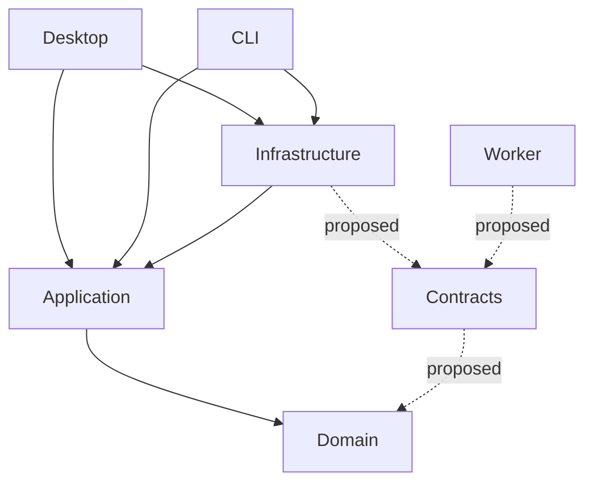
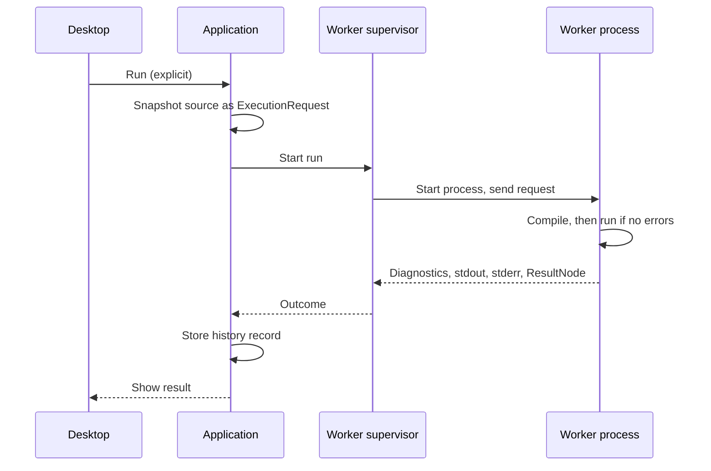

# CodePad architecture

This page states the module boundaries, the worker trust boundary and the storage rules for v0.1.
The owner issues hold the detailed rules. When this page and an owner issue disagree, the owner
issue wins. Fix this page in the same change.

For the product scope, see [PRODUCT.md](PRODUCT.md).

## Current state

The repository has one .NET 11 console project, `src/Codepad`. The modules below are the target
design. [#1] creates them. Update this section when the projects exist.

## Modules

[#1] defines these modules. It can combine modules into one assembly where that has a reason.

| Module | Holds | Must not depend on |
| --- | --- | --- |
| Domain | Experiment, execution request, outcomes, diagnostics, `ResultNode`, policies. See [#2]. | Avalonia, Roslyn, SQLite, OS APIs |
| Application | Use cases and the interfaces that they need, for example `IUpdateService`. | Avalonia, SQLite, OS APIs |
| Infrastructure | Adapters for IO: SQLite storage, the worker supervisor, the GitHub Releases client, the update verifier. | Desktop |
| Contracts | The versioned messages between the app and the worker. See [#4]. | Desktop, Infrastructure |
| Worker | The child process that compiles and runs one C# snippet with Roslyn. See [#4]. | Desktop, Infrastructure, Application |
| Desktop | The Avalonia UI and the composition root. | (the composition root can use all modules) |
| CLI | The `codepad` command for agents and scripts. A second composition root. See [#19]. | Desktop |

The diagram shows which module uses which module. Domain uses no other module. Desktop and CLI
are composition roots. They share the same use cases. The worker shares only the contracts with
the app.

The arrows to and from Contracts and Worker are **proposed**. No issue states them. [#1], [#2] and
[#4] decide them. See V-13 in [Open validation questions](#open-validation-questions).

Tests check the dependency direction. See [#1] and [#2].

### Dependency rules

- Domain is independent. It has no IO and no UI types.
- Application owns the use cases. It declares an interface for each IO need.
- Infrastructure implements those interfaces.
- Desktop creates the objects and connects them. It holds no business rules.
- The CLI uses the same use cases as Desktop. It does not copy run, JSON or storage logic. Its
  standard output holds only the versioned JSON result. See [#19].
- The editor sends content changes to autosave through an interface. The editor does not use
  SQLite. See [#5].
- Completion and diagnostics use one Roslyn language service, separate from the worker. See [#5]
  and [#6].
- v0.1 has no plugin framework, no provider registry and no feature-flag framework. See [#1],
  [#2] and [#12].

### Platform adapters

Shared code does not call OS-specific APIs. Each item below is behind a small adapter with a Linux
and a Windows implementation:

- Data and config folders. See [#3] and [#13].
- Worker start, process tree stop and pipes. See [#4] and [#14].
- Key handling. See [#13].
- Update install, restart and rollback (`IUpdateInstaller`). See [#17].
- Packaging. See [#15].

## Operations

CodePad has two modes. Both use the same experiment, diagnostic and `ResultNode` contracts. See
[#2] and [#9].

| | C# run | Live JSON |
| --- | --- | --- |
| Starts | Only on an explicit Run | After a short pause in typing |
| Runs in | A new worker process for each run | A side-effect-free provider that uses `System.Text.Json` |
| Input | An immutable snapshot of the source | The current document revision |
| History | One immutable record for each run | No history record for each key press |
| Limits | Time limit, output limits, result limits | Document size and nesting limits |
| Old results | Each run has its own record | A result for an old revision is dropped |

### C# run flow

The diagram shows one explicit run. The app takes a snapshot first. The worker never reads the
editor or the database.

Rules for the run. See [#4] and [#7].

- The worker compiles first. If compilation fails, the outcome is `CompilationFailed` and user
  code does not run.
- The outcomes are `Success`, `CompilationFailed`, `RuntimeFailed`, `Canceled`, `TimedOut` and
  `WorkerFailed`. A process exit code is not an outcome.
- IPC messages have a version and a size limit. The IPC traffic is separate from the user's
  stdout.
- The supervisor stops the full process tree on timeout or cancel.
- The worker converts .NET values to `ResultNode`. It limits depth, item count and text size. It
  does not call arbitrary property getters unless the policy allows it.
- The UI shows large tables and trees with virtualization.

### Live JSON flow

- Each evaluation has the experiment, the document revision and a sequence number. See [#9].
- When a newer revision exists, the app drops the old result, also if it could not cancel the work.
- A parse error has a line and a position. The input stays as the user typed it.

## Worker trust boundary

The worker process is a **crash boundary**. It is **not a security sandbox**.

| The worker process does | The worker process does not |
| --- | --- |
| Keep the UI responsive while code runs | Limit file, network or OS access |
| Contain a crash, a hang or a bad message | Protect against malicious code |
| Let the app stop runaway code with its process tree | Give the same resource limits on Linux and Windows |

User code runs with the permissions of the user who runs CodePad. CodePad runs only code that its
caller trusts. In the desktop app, the caller is the user. In the CLI, the caller is the user or
agent that starts the command. The CLI uses the same worker and the same limits. See [#19]. For this reason, no path runs C# code automatically: edit, autosave, history
selection, session restore, a newly opened experiment, import and startup do not start a run. See
[#4] and [#14].

The release documentation states this limit. See [#15].

## Storage and retention

- One SQLite database in the per-user data folder. See [#3].
- The schema has a version. Migrations are controlled.
- Each write is a transaction. The UI shows dirty, saving, saved and error states. The app does not
  say "saved" before the commit is durable.
- Each experiment has a revision number. An older write cannot replace a newer revision.
- Separate tables hold experiments, settings, run history ([#8]) and the tab session ([#10]).
- A run history record is immutable. A change to the experiment does not change it.
- Retention keeps 100 history records for each experiment by default. It deletes the oldest
  records first. It never deletes an experiment or the current source. See [#8] and [#13].
- Clear history needs a confirmation. It deletes run records only. See [#13].
- Startup restores the last committed state. It does not run it. See [#3].
- An update must keep the database. A migration must work with the rollback plan: back up before a
  destructive migration, or block an irreversible migration. See [#17].

## Updater boundaries

[#17] holds the full contract.

- Application: `IUpdateService` checks, downloads, compares versions and reports status.
- Infrastructure: the GitHub Releases client, the manifest and signature verifier and the staged
  downloader.
- Platform adapter: `IUpdateInstaller` does the handoff, the restart and the rollback on each OS.
- Desktop: the update UI in Settings and About, and a small notice when an update is available.
- The public verification key ships in the app. The signing key stays with the owner. No agent
  publishes a release.

## Logging

See [#14] and [#17].

- Log structured events with the operation ID, the duration, the status and the reason for a
  retry or a stop.
- Do not log source, input, results, secrets, tokens or personal file paths by default.

## Open validation questions

The owner issues leave these questions open. Resolve each one in its owner issue during
implementation. Record a durable decision as an ADR in `docs/adr/` when it passes the ADR test.

| ID | Question | Owner |
| --- | --- | --- |
| V-01 | Which modules share one assembly? | [#1] |
| V-02 | Which logging library and which UI smoke test tool? | [#1] |
| V-03 | Which C# script form: Roslyn scripting or top-level statements? How does the last expression become the result? | [#4] |
| V-04 | Which IPC transport and framing: standard streams or local pipes, length-prefixed or line-delimited JSON? | [#4] |
| V-05 | Which process tree stop works on each OS? Which resource limits are not available on one OS? | [#4], [#14] |
| V-06 | Which Avalonia editor component? Check it for selection, undo, IME, zoom and accessibility. | [#5] |
| V-07 | Which XDG fallback folders on Linux? | [#3] |
| V-08 | Is a plain bounded SQLite query fast enough for search, or is FTS needed? Measure first. | [#11] |
| V-09 | Does live JSON evaluation run in the desktop process on a background thread? | [#9] |
| V-10 | Which Linux artifact format: an archive or a distribution package? | [#15] |
| V-11 | Which signature scheme for the update manifest, and how does the owner keep the key? | [#15], [#17] |
| V-12 | How does the update helper replace the app and roll back on each OS? | [#17] |
| V-13 | Do Contracts use Domain to carry `ResultNode`? Does Worker use only Contracts? | [#1], [#2], [#4] |
| V-14 | How do the CLI and a running desktop app share one SQLite database safely? | [#3], [#19] |
| V-15 | Is the CLI a separate executable or a mode of the desktop executable? How does it get on the PATH? | [#15], [#17], [#19] |

[#1]: https://github.com/daniel-kindl/codepad/issues/1
[#2]: https://github.com/daniel-kindl/codepad/issues/2
[#3]: https://github.com/daniel-kindl/codepad/issues/3
[#4]: https://github.com/daniel-kindl/codepad/issues/4
[#5]: https://github.com/daniel-kindl/codepad/issues/5
[#6]: https://github.com/daniel-kindl/codepad/issues/6
[#7]: https://github.com/daniel-kindl/codepad/issues/7
[#8]: https://github.com/daniel-kindl/codepad/issues/8
[#9]: https://github.com/daniel-kindl/codepad/issues/9
[#10]: https://github.com/daniel-kindl/codepad/issues/10
[#11]: https://github.com/daniel-kindl/codepad/issues/11
[#12]: https://github.com/daniel-kindl/codepad/issues/12
[#13]: https://github.com/daniel-kindl/codepad/issues/13
[#14]: https://github.com/daniel-kindl/codepad/issues/14
[#15]: https://github.com/daniel-kindl/codepad/issues/15
[#16]: https://github.com/daniel-kindl/codepad/issues/16
[#17]: https://github.com/daniel-kindl/codepad/issues/17
[#19]: https://github.com/daniel-kindl/codepad/issues/19
